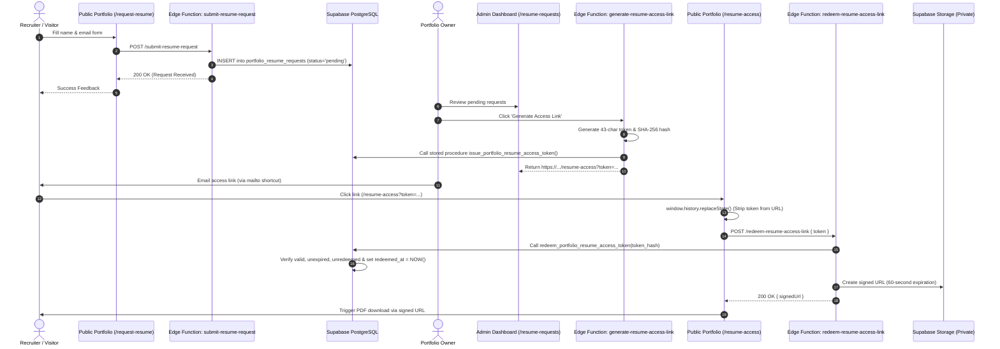

<div align="center">

# Richard D'souza

### High-Performance Developer Portfolio & Interactive Engineering Showcase

A cinematic, production-grade developer portfolio engineered with **React 19**, **TypeScript**, **Vite**, and **Tailwind CSS v4**. Features custom **Three.js** particle fields, **GSAP** timeline choreography, **Motion** micro-interactions, an embedded **Spotify** soundscape player, client-side cryptographic defense, and dynamic headless content hydration via **Supabase**.

[](https://richard-portfolio-website-ten.vercel.app)
[](https://richard-portfolio-admin.vercel.app)
[](https://github.com/aestheticwolf)

---

[](https://react.dev/)
[](https://www.typescriptlang.org/)
[](https://vitejs.dev/)
[](https://tailwindcss.com/)
[](https://supabase.com/)
[](https://vercel.com/)

[Overview](#-overview) • [System Architecture](#-system-architecture) • [Engineered Features](#-engineered-features) • [Featured Projects](#-featured-projects) • [Workflows & Diagrams](#-workflows--data-flows) • [Security Model](#-security-architecture) • [Tech Stack](#-tech-stack) • [Directory Structure](#-project-structure) • [Setup & Development](#-getting-started) • [Admin Integration](#-admin-dashboard-integration) • [Troubleshooting](#-troubleshooting)

</div>

---

## 🔭 Overview

This portfolio serves as both an interactive digital identity and an engineered showcase of modern software craftsmanship. Designed from first principles, it is built as a responsive, GPU-accelerated single-page application that balances cinematic visual design with strict accessibility compliance, low bundle overhead, and zero-downtime offline resilience.

### Core Objectives

- **High-Fidelity Interaction Design:** Deliver smooth 60fps animations utilizing Three.js and GSAP without sacrificing lighthouse performance or mobile battery life.
- **Headless Content Architecture:** Dynamic hydration from a Supabase PostgreSQL database for published projects, developer telemetry, and public music collections, backed by a static fallback layer for offline resilience.
- **Gated Cryptographic Asset Delivery:** Secure, single-use, time-limited token redemption for private resume downloads via Supabase Edge Functions and signed Storage URLs.
- **Complete Theme & Accessibility Parity:** Dual-mode design system (Midnight Aurora & Clean Light) with strict reduced-motion fallbacks, zero layout shift (CLS), and keyboard-navigable dialogs.

---

## 🏛 System Architecture

The public portfolio operates as an independent, statically-hosted client on Vercel, decoupled from the private administration control plane while sharing a centralized Supabase infrastructure.

```mermaid
graph TD
    subgraph Client Application (richard-portfolio)
        A[Visitor Browser] -->|Initial Page Load| B[Cinematic Preloader: Three.js + GSAP]
        B --> C[Spatial Hero Console & Mascot]
        C --> D[Constellation Canvas Particle Mesh]
        A -->|Navigation /projects/:slug| E[Dynamic Project Details View]
        A -->|Global FAB Trigger| F[Floating Spotify Player]
        A -->|Form Action /request-resume| G[Resume Request Portal]
        A -->|Token Landing /resume-access| H[Token Redemption Gateway]
    end

    subgraph Data & Hydration Layer
        C -.->|getPublishedProfile| I[(Supabase: portfolio_profile)]
        E -.->|getPublishedProjects| J[(Supabase: projects)]
        F -.->|fetchPublicPlaylists| K[(Supabase: music_playlists)]
        
        %% Offline Fallback Paths
        C -.->|Network Fallback| L[static DEFAULT_HERO_CONSOLE]
        E -.->|Network Fallback| M[static src/data/projects.ts]
        F -.->|Network Fallback| N[static music.config.ts presets]
    end

    subgraph Edge Security Layer
        G -->|submit-resume-request| O[Supabase Edge Function]
        O -->|Service Role Write| P[(portfolio_resume_requests)]
        
        H -->|redeem-resume-access-link| Q[Supabase Edge Function]
        Q -->|Stored Proc: SHA-256 Hash Validation| R[(portfolio_resume_access_tokens)]
        Q -->|Generate Signed URL 60s| S[Private Storage: resumes]
        S -->|Redirect Direct Download| A
    end

    subgraph Admin Control Plane (Separate App)
        T[richard-portfolio-admin] -->|Authenticated Mutations| I
        T -->|Authenticated Mutations| J
        T -->|Authenticated Mutations| K
        T -->|Approve & Generate Token| Q
    end
```

---

## ⚡ Engineered Features

### 1. Cinematic Three.js & GSAP Preloader
- **Procedural Depth Field:** Renders an ambient 3D orbital particle field directly on an HTML5 `<canvas>` via Three.js using procedurally generated textures (zero external image requests).
- **Parallax Mouse Interaction:** Smooth camera perspective interpolation (`lerp`) responding to cursor coordinates during loading.
- **GSAP Timeline Coordination:** Choreographed sequence animating brand typography, laser progress bar, and status indicators.
- **Accessibility & Failsafe:** Respects the OS-level `prefers-reduced-motion` flag for an instant transition and includes a 4.5-second safety timer to prevent hung states.

### 2. Spatial Hero Console & Interactive Mascot
- **Simulated Terminal Console:** Interactive CLI widget (`richard --status`) rendering live developer focus areas, education telemetry, technical specializations, and real-time availability.
- **Procedural Chibi Mascot:** Custom-illustrated chibi avatar with interactive cursor-tracking, blinking eye animations, and contextual greeting speech bubbles.
- **Constellation Background Canvas:** Custom high-DPI particle mesh connecting dynamic constellation line vertices with energetic laser pulses and scroll velocity parallax.

### 3. Integrated Spotify Soundscape Experience
- **Adaptive Layout Architecture:** Official Spotify embed automatically renders at **80px** on mobile viewports ($<$ 640px) to eliminate unpainted cross-origin iframe white space, and **152px** on desktop viewports to display playlist tracklists.
- **Persistent Playback:** The iframe container remains mounted across route navigation and panel open/close/minimize actions, preserving playback continuity.
- **Soundscape Presets:** Quick-switching between curated developer audio soundscapes (Chill Coding & Lo-Fi, Synthwave & Retrowave, Deep Focus & Ambient) using smooth horizontal scrolling on mobile and a structured grid on desktop.
- **Zero Cross-Contamination:** Strict Supabase RLS isolation ensures visitor soundscapes are queried strictly from `collection = 'public'`, completely independent from private administrative soundscapes.
- **Live Soundwave Equalizer:** Synchronized CSS keyframe equalizers responsive to playback states.

### 4. Cryptographic Resume Access Pipeline
- **Request Submission (`/request-resume`):** Visitors submit their name and email, verified client-side and dispatched to a rate-limited Supabase Edge Function (`submit-resume-request`).
- **Gated Token Redemption (`/resume-access`):** Secure access links containing 43-character cryptographic tokens are validated by `redeem-resume-access-link`, instantly replacing browser history to prevent URL retention.
- **Short-Lived Signed URLs:** The server exchanges valid tokens for temporary signed URLs pointing to a private Supabase Storage bucket, protecting sensitive documents from automated web scraping.

### 5. Multi-Layer Client-Side Form Defense
Implemented in `src/lib/contactSecurity.ts`:
- **Honeypot Trap:** Hidden decoy inputs trap automated spam bots.
- **Submission Velocity Checking:** Discards submissions completed faster than humanly possible ($<$ 2 seconds).
- **Sliding-Window Rate Limiting:** Enforces a maximum of 3 messages per rolling hour with a 60-second cooldown between consecutive dispatches.
- **Duplicate Payload Signatures:** Hashes recent submissions to suppress repeated click spamming.
- **Web3Forms Delivery:** Dispatches verified clean contact submissions to Web3Forms without requiring custom email server maintenance.

### 6. Deep Project Case Studies (`/projects/:slug`)
- Dynamic routing with instant scroll restoration to top.
- Full architectural overviews, technical challenges, and key deliverables.
- Interactive full-screen gallery lightbox with keyboard navigation (`Esc`, `←`, `→`).
- Privacy-friendly YouTube video embeds with automated URL parser.
- Sequential project pagination.

### 7. Midnight Aurora Design System
- Custom theme engine toggling between dark **Midnight Aurora** (obsidian `#0a0d18`, violet `#a78bfa`, and emerald `#34d399`) and a high-contrast light theme.
- Persisted via `localStorage` with zero Flash of Unstyled Content (FOUC).
- GPU-accelerated 3D tilt cards with specular light reflection.

---

## 💼 Featured Projects

The portfolio dynamically loads projects from the database, falling back to static bundled definitions when offline:

| Project | Category | Tech Stack | Highlights | Repository |
| :--- | :--- | :--- | :--- | :---: |
| **CRM System Integration** | Web App · AI | React, Express, TypeScript, Prisma, SQLite, Gemini AI | Customer tracking, communication history, AI customer summaries, mock WooCommerce sync. | [GitHub](https://github.com/aestheticwolf/crm-system-integration) |
| **SkillPath** | Mobile App | React Native, Expo, TypeScript, Firebase | Learning companion organizing structured study goals, tasks, and progress tracking. | [GitHub](https://github.com/aestheticwolf) |
| **Sentinel Grid** | Web App · Security | React, Node.js, Express, MongoDB, JWT | Security guard patrol monitoring system, authenticated access control, real-time logging. | [GitHub](https://github.com/aestheticwolf) |
| **Art by Heaven** | Mobile · E-Commerce | Flutter, Firebase, Cloud Firestore, Razorpay | Artisan e-commerce mobile application featuring product catalog, cart workflows, and Razorpay integration. | [GitHub](https://github.com/aestheticwolf) |

---

## 🔄 Workflows & Data Flows

### Resume Request, Approval & Token Redemption Sequence


---

## 🔒 Security Architecture

### Layered Defense Model

```mermaid
graph LR
    subgraph Client Layer (Defense in Depth)
        A[Honeypot Trap] --> B[Velocity Limiter]
        B --> C[Sliding Window Rate Limit]
        C --> D[Duplicate Payload Hash]
    end

    subgraph Network Layer
        D -->|HTTPS + Anon Public Key| E[Supabase API Gateway]
    end

    subgraph Serverless & Database (True Enforcement)
        E --> F{PostgreSQL RLS}
        F -->|Anon Read-Only Filter| G[status='published']
        F -->|Public Music Filter| H[collection='public' AND is_active=true]
        E --> I[Edge Functions Deno Runtime]
        I -->|Service Role Execution| J[Private Storage & Token Hashes]
    end
```

### Verified Security Controls vs Client-Side Protections

| Security Control | Implementation Mechanism | Enforcement Tier | Security Guarantee |
| :--- | :--- | :--- | :--- |
| **Row-Level Security (RLS)** | PostgreSQL native RLS policies | **Server-side** (Authoritative) | Unauthenticated visitors can never read drafts, administrative data, or private playlists. |
| **Resume Download Gating** | Storage signed URLs with 60s expiration | **Server-side** (Authoritative) | Direct public download URLs do not exist; master PDF cannot be scraped. |
| **Token Cryptography** | 43-character CSPRNG token stored as SHA-256 | **Server-side** (Authoritative) | Tokens are single-use; database leak cannot reveal plaintext redemption tokens. |
| **Contact Form Anti-Spam** | Honeypot & 2s submission velocity | **Client-side** (Defense in Depth) | Filters out unsophisticated bots without degrading user experience with CAPTCHAs. |
| **Client Rate Limiting** | `localStorage` sliding hourly counter | **Client-side** (Defense in Depth) | Throttles excessive repeated manual submissions in the browser session. |

> [!IMPORTANT]
> The public client application communicates with Supabase strictly using the **Anon Publishable Key** (`VITE_SUPABASE_PUBLISHABLE_KEY`). The high-privilege **Service Role Key** is never bundled or accessible to client code.

---

## 🛠 Tech Stack

### Core Framework & Build
- **React 19.3.1:** Modern component primitives, concurrent state transitions.
- **TypeScript 5.9.3:** Strict type checking across data models, components, and API contracts.
- **Vite 8.3.5:** High-performance frontend tooling with instant HMR and Rollup optimization.
- **React Router 7.18.5:** Declarative client-side routing with deep link resolution.

### Styling & Graphics
- **Tailwind CSS v4.3.3:** CSS-first utility engine with custom variables.
- **Three.js (0.187.0):** WebGL rendering for the preloader and hero background meshes.
- **GSAP 3.15.1:** Precision timeline choreography for the introductory sequence.
- **Motion 14.7.1:** Declarative gesture animations, layout transitions, and spring physics.

### Backend, BaaS & Cloud
- **Supabase 2.118.0:** PostgreSQL database with Row-Level Security, Auth, Edge Functions, and Storage.
- **Web3Forms:** Serverless contact form submission endpoint.
- **Vercel:** Edge-cached production hosting and continuous deployment.

---

## 📂 Project Structure

```
richard-portfolio/
├── public/                       # Static public assets
│   ├── images/                   # Mascot sprites and chibi animations
│   ├── favicon.svg               # Vector brand icon
│   └── robots.txt                # Search crawler configuration
├── src/
│   ├── assets/                   # Bundled graphics and hero media
│   ├── components/               # Reusable UI component library
│   │   ├── music/                # Floating Spotify player suite
│   │   │   ├── MusicButton.tsx   # Global navigation bar trigger
│   │   │   ├── MusicContext.tsx  # Music state provider & hook
│   │   │   ├── MusicEqualizer.tsx# Animated CSS soundwave bars
│   │   │   ├── MusicPlayer.tsx   # Floating responsive popover modal
│   │   │   ├── SpotifyEmbed.tsx  # Adaptive 80px/152px Spotify iframe
│   │   │   └── music.config.ts   # Default presets & embed formatters
│   │   ├── BackgroundAnimation.tsx # Canvas particle mesh network
│   │   ├── CinematicSection.tsx  # Scroll-triggered viewport reveal
│   │   ├── CosmicHorizonDivider.tsx # Ambient section divider
│   │   ├── CustomCursor.tsx      # Smooth-trailing desktop cursor
│   │   ├── PortfolioPreloader.tsx# Three.js + GSAP loader sequence
│   │   ├── SpatialHeroConsole.tsx# Mascot & interactive terminal
│   │   ├── ThemeToggle.tsx       # Dark/Light theme mode switcher
│   │   └── TiltCard3D.tsx        # 3D interactive tilt cards
│   ├── data/
│   │   └── projects.ts           # Bundled static fallback projects
│   ├── lib/                      # Core business logic & SDK clients
│   │   ├── contactSecurity.ts    # Rate limiting & anti-spam defense
│   │   ├── profile.ts            # Profile data hydration from Supabase
│   │   ├── projects.ts           # Project data hydration from Supabase
│   │   ├── publicPlaylists.ts    # Supabase public music library client
│   │   ├── resumeAccess.ts       # Secure token redemption client
│   │   ├── resumeRequest.ts      # Edge function request dispatcher
│   │   ├── smoothScroll.ts       # Momentum scroll utility
│   │   └── supabase.ts           # Initialized Supabase client instance
│   ├── pages/                    # Routed application views
│   │   ├── ProjectDetails.tsx    # Dynamic project case study (/projects/:slug)
│   │   ├── RequestResume.tsx     # Recruiter resume request (/request-resume)
│   │   └── ResumeAccess.tsx      # Token redemption screen (/resume-access)
│   ├── App.tsx                   # Master layout, navigation, and routes
│   ├── index.css                 # Global tokens, resets, and theme vars
│   └── main.tsx                  # React DOM root entry point
├── .env.example                  # Environment variable blueprint
├── package.json                  # Dependencies, metadata, and scripts
├── tsconfig.json                 # TypeScript compiler configuration
├── vercel.json                   # Single-page application route rewrites
└── vite.config.ts                # Vite plugin configuration
```

---

## 🚀 Getting Started

### Prerequisites

- **Node.js:** `v18.0.0` or higher (Node `v20+` recommended)
- **Package Manager:** `npm` (or `pnpm` / `yarn`)

### Installation

1. **Clone the repository:**
   ```bash
   git clone https://github.com/aestheticwolf/richard-portfolio-website.git
   cd richard-portfolio-website
   ```

2. **Install project dependencies:**
   ```bash
   npm install
   ```

3. **Configure environment variables:**
   Copy the `.env.example` template into a local `.env` file:
   ```bash
   # On Windows PowerShell
   Copy-Item .env.example .env

   # On POSIX Shell (Linux / macOS)
   cp .env.example .env
   ```

   Provide your credentials:
   ```ini
   # Supabase Project URL & Anon Key (from your Supabase Project Settings -> API)
   VITE_SUPABASE_URL=https://your-supabase-project.supabase.co
   VITE_SUPABASE_PUBLISHABLE_KEY=your_supabase_anon_publishable_key

   # Contact Form Key (Free from https://web3forms.com)
   VITE_WEB3FORMS_ACCESS_KEY=your_web3forms_access_key
   ```

4. **Launch development server:**
   ```bash
   npm run dev
   ```
   The application will boot at `http://localhost:5173`.

### Production Build & Quality Assurance

```bash
# Typecheck and compile production bundle
npm run build

# Run ESLint validation
npm run lint

# Preview production build locally
npm run preview
```

---

## ⚙️ Environment Configuration

| Variable | Scope | Purpose | Required |
| :--- | :--- | :--- | :--- |
| `VITE_SUPABASE_URL` | Public (Client) | HTTPS endpoint for Supabase PostgreSQL & Storage API. | **Yes** |
| `VITE_SUPABASE_PUBLISHABLE_KEY` | Public (Client) | Anon key for Supabase client queries, governed by RLS. | **Yes** |
| `VITE_WEB3FORMS_ACCESS_KEY` | Public (Client) | Free access key from Web3Forms for contact form email routing. | **Yes** |

---

## 🔒 Admin Dashboard Integration

The public portfolio is paired with a companion application: **Richard Portfolio Admin** (`richard-portfolio-admin`).

### Operational Relationship
- **Decoupled Architecture:** The public portfolio requires only public, read-only anon permissions via Postgres Row-Level Security (RLS). Even if the administrative dashboard is offline, the public website remains fully functional.
- **Published Content Control:** Edits made in the Admin Dashboard to projects, bio information, and soundscapes are instantly reflected on the public portfolio upon publishing.
- **Audited Resume Access:** When a recruiter requests a resume on the public site, the request is recorded in Supabase and surfaced in the admin dashboard for one-click approval and automated single-use token issuance.
- **Dual Soundscape Management:** The admin dashboard manages both `public` and `admin` music libraries independently within the same database, preventing private admin playlists from leaking to public visitors.

---

## 🔧 Troubleshooting

### 1. Supabase Data Not Showing / Offline Mode Active
- **Symptom:** Portfolio displays default seed projects and default bio without error.
- **Cause:** `VITE_SUPABASE_URL` or `VITE_SUPABASE_PUBLISHABLE_KEY` is missing or invalid.
- **Remedy:** Check your `.env` file. The portfolio is built to gracefully fall back to local seed data in `src/data/projects.ts` when Supabase is unreachable.

### 2. Contact Form Returns Error on Submit
- **Symptom:** Submitting the contact form returns "Unable to send message".
- **Cause:** `VITE_WEB3FORMS_ACCESS_KEY` is missing or expired.
- **Remedy:** Generate a free key from [web3forms.com](https://web3forms.com) and assign it to `VITE_WEB3FORMS_ACCESS_KEY` in `.env`.

### 3. Spotify Embed Shows White Space on Mobile
- **Symptom:** White rectangle beneath Spotify embed controls on small viewports.
- **Cause:** Iframe height fixed to 152px while Spotify responsive script only renders 80px on narrow mobile viewports.
- **Remedy:** `SpotifyEmbed.tsx` dynamically switches iframe height to `80px` when `window.innerWidth < 640px`. Ensure CSS container uses matching height.

---

## 🗺 Roadmap & Planned Enhancements

- [x] Three.js procedural depth field preloader.
- [x] Dynamic project case study routes (`/projects/:slug`).
- [x] Dual independent Spotify music libraries (Public vs Admin).
- [x] Cryptographic single-use resume token delivery.
- [ ] Blog / Technical Writings section powered by Supabase Markdown.
- [ ] Interactive 3D project architecture explorer using Three.js.
- [ ] Multi-language localization (i18n).

---

## 👤 Developer Profile

**Richard D'souza**  
*Software Developer*  
Goa, India

- **GitHub:** [@aestheticwolf](https://github.com/aestheticwolf)
- **Live Portfolio:** [richard-portfolio-website-ten.vercel.app](https://richard-portfolio-website-ten.vercel.app)
- **Admin Dashboard:** [richard-portfolio-admin.vercel.app](https://richard-portfolio-admin.vercel.app)

---

## 📄 License

This repository and its source code are published for showcase, code review, and evaluation purposes. All rights reserved by the author.
